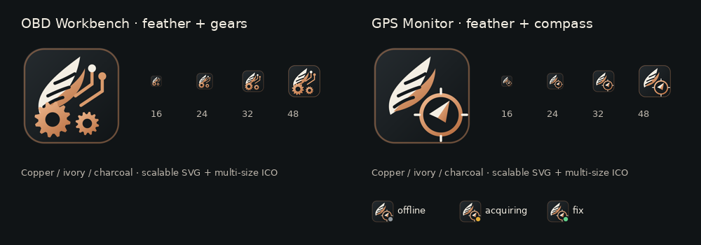

# Icarus Offroad — OBD Workbench

Windows vehicle diagnostics, source-aware live telemetry, gauges, trends, GPS and CSV recording/replay. **v0.5.0.0 · r30 public test preview.**



## Start here

- [Build and publish](docs/BUILDING.md)
- [Quick start](docs/QUICK_START.md) and [user guide](docs/USER_GUIDE.md)
- [GPS connection and installation](docs/GPS.md)
- [Compatibility and known limits](docs/KNOWN_LIMITATIONS.md)
- [Documentation index](docs/README.md)

The desktop application targets Windows 10/11 with .NET 8. A .NET 8 SDK is required to build. The shared Core project is portable, but this repository does **not** ship a Linux, Android or iOS GUI.

## Build from source

Extract the complete source ZIP into a new writable folder, or clone this repository. On Windows with the .NET 8 SDK installed:

```powershell
.\build.bat
.\test-core.bat
```

Run `OBDWorkbench/bin/Release/net8.0-windows/OBDWorkbench.exe`. The framework-dependent build requires the .NET 8 Desktop Runtime on the machine running it. For a self-contained x64 build run `publish-win-x64.bat`; its output is under `OBDWorkbench/bin/Release/net8.0-windows/win-x64/publish/`. Distribute the whole publish folder so data and documentation are included. Initial dependency restore needs internet access.

## What it does

| Path | Interface | Preview capability |
| --- | --- | --- |
| Generic OBD-II | ELM327/STN over serial or TCP | Discovery, live signals, DTCs, recording and replay; depends on vehicle and adapter |
| Subaru SSM2 | Supported raw K-Line/KKL adapter | BF capabilities, live data, recognized DTC layouts; guarded clear on the validated ECU fingerprint |
| Land Rover TD5 | Supported raw K-Line/KKL adapter | Session/security, live data, fault bitmap; guarded clear on the known early/10P development profile |
| Land Rover GEMS | ELM/STN dealer session | Experimental initialization/security and reads; independent vehicle validation remains |
| GPS | Direct NMEA COM port or Icarus GPS Service | Speed, position, altitude, course, satellites used, HDOP and valid-fix channels |
| DRB | — | Disabled placeholder; no public microPOD/DRB implementation in this package |

Both desktop skins support live numeric signals, pinned readings, configurable gauges, multi-signal trends, gain/offset and precision settings, calculated values, CSV recording/replay, event markers, ECU/source identification and locally generated Support ZIPs.

## GPS in one minute

Open **Preferences → GPS connection and NMEA debug**, select **Direct COM port** or **Icarus GPS Service**, and check **Enable GPS in Workbench**. Selecting the source alone does not enable reception. Settings save automatically. Receiver/service status and NMEA diagnostics are available before a position fix; speed and position remain unavailable until valid.

Already running Icarus GPS Service? Select it directly: **no virtual COM port or reinstallation is needed**. First-time installation uses the complete bundled source in [GPSService](GPSService/README_WORKBENCH.md). Workbench and the GPS service build/install separately. Service mode lets the monitor/widget and Workbench share one physical receiver.

## Repository layout

| Folder | Contents |
| --- | --- |
| `OBDWorkbench/` | WPF application, UI models, controls, runtime data and splash artwork |
| `OBDWorkbench.Core/` | Protocols, parsers, logging/replay, settings and read-only GPS service client |
| `OBDWorkbench.Platform.Windows/` | Windows serial and raw K-Line transports |
| `RegressionTests/` | Shared-Core behavioral and transport integration checks |
| `GPSService/` | Independently buildable GPS service, monitor and desktop widget |
| `docs/` | User/developer guides, testing, references and archived patch notes |
| `Branding/` | SVG originals, PNG previews, multi-size ICOs and icon-generation script |
| `ReferenceData/` | SSM factual DTC mapping table and provenance |
| `scripts/` | Source-package/documentation validation |

## Preview status and contribution

This is a public **test preview**, not a claim of compatibility with every ECU or adapter. See [validation status](docs/VALIDATION.md) and the [release checklist](docs/RELEASING.md). The GPS service subscription without a location fix has been confirmed on the development Windows PC; final taskbar-icon and release-machine checks remain.

Read [CONTRIBUTING.md](CONTRIBUTING.md) for bug reports and changes. Review Support ZIPs before posting: GPS coordinates and route history are not automatically removed. There is no automatic upload or cloud account requirement.

## License and provenance

Project-authored source and branding are offered under the [MIT License](LICENSE). Retain the [third-party notices](THIRD_PARTY_NOTICES.md), including the TD5 BSD notice. [Sources](docs/SOURCES.md), [reference-data provenance](ReferenceData/README.md) and the [communications reference](COMMUNICATIONS_REFERENCE.md) distinguish implementation, protocol facts and vehicle observations. No third-party manuals, proprietary diagnostic databases or recovered utility binaries are bundled. This license is not a claim that referenced third-party projects or standards have been relicensed.
